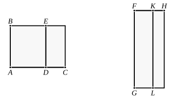

I say that the “side” of the remainder ">$EC$ becomes one 
of two irrational straight lines, either a first apotome of a 
medial straight line or a straight line which produces with a 
rational area a medial whole.

For let a rational straight line $FG$ be set out, 
and let the areas be similarly applied.

It follows then that $FH$ is rational and incommensurable 
in length with $FG$, 
while $KF$ is rational and commensurable in length with $FG$;

therefore $FH$, $FK$ are rational straight lines commensurable 
in square only; [x. 13] 
therefore $KH$ is an apotome, and $FK$ the annex to it. [x. 73]

Now the square on $HF$ is greater than the square on $FK$ 
either by the square on a straight line commensurable with 
$HF$ or by the square on a straight line incommensurable 
with it.

If then the square on $HF$ is greater than the square on 
$FK$ by the square on a straight line commensurable with $HF$, 
while the annex $FK$ is commensurable in length with the 
rational straight line $FG$ set out,

$KH$ is a second apotome. [x. Deff. III. 2]

But $FG$ is rational;

so that the “side” of ">$LH$, that is, of ">$EC$, is a first apotome of 
a medial straight line. [x. 92]

But, if the square on $HF$ is greater than the square on 
$FK$ by the square on a straight line incommensurable with $HF$, 
while the annex $FK$ is commensurable in length with the 
rational straight line $FG$ set out,

$KH$ is a fifth apotome; [x. Deff. III. 5] 
so that the “side” of ">$EC$ is a straight line which produces 
with a rational area a medial whole. [x. 95]

