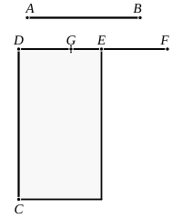

Then $u$ is rational and $\smile \sigma$,
$v$ is rational and $\smile \sigma$,
and
$$u \smile v.$$

Therefore $u, v$ are rational and $\sim$,
so that $(u - v)$ is an apotome.

Now either
(1) $\sqrt{u^2 - v^2} \mathbin{\Cap} u$,
or (2) $\sqrt{u^2 - v^2} \smile u$,
while in both cases both $u$ and $v$ are $\smile \sigma$.

In case (1) $(u - v)$ is a *third apotome*,
and in case (2) $(u - v)$ is a *sixth apotome*,
so that $\sqrt{\sigma (u - v)}$ is either (1) a *second apotome of a medial straight line* [x. 93],
or (2) a "*side" of the difference between two medial areas* [x. 96].

---

### PROPOSITION 111.

*The apotome is not the same with the binomial straight line.*

Let $AB$ be an apotome;
I say that $AB$ is not the same with the binomial straight line.

For, if possible, let it be so;
let a rational straight line $DC$ be set out,
and to $CD$ let there be applied the rectangle ">$CE$ equal to the square on $AB$ and producing $DE$ as breadth.

Then, since $AB$ is an apotome,
$DE$ is a first apotome. [x. 97]

Let $EF$ be the annex to it;
therefore $DF$, $FE$ are rational straight lines commensurable in square only,
the square on $DF$ is greater than the square on $FE$ by the square on a straight line commensurable with $DF$,
and $DF$ is commensurable in length with the rational straight line $DC$ set out. [x. Deff. III. 1]

Again, since $AB$ is binomial,
therefore $DE$ is a first binomial straight line. [x. 60]

Let it be divided into its terms at $G$,
and let $DG$ be the greater term;
therefore $DG$, $GE$ are rational straight lines commensurable in square only,
