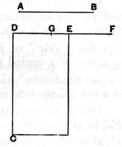

Then $u$ is rational and $\smile \sigma$,
$v$ is rational and $\smile \sigma$,
and
$$u \smile v.$$

Therefore $u, v$ are rational and $\sim$,
so that $(u - v)$ is an apotome.

Now either
(1) $\sqrt{u^2 - v^2} \mathbin{\Cap} u$,
or (2) $\sqrt{u^2 - v^2} \smile u$,
while in both cases both $u$ and $v$ are $\smile \sigma$.

In case (1) $(u - v)$ is a *third apotome*,
and in case (2) $(u - v)$ is a *sixth apotome*,
so that $\sqrt{\sigma (u - v)}$ is either (1) a *second apotome of a medial straight line* [x. 93],
or (2) a "*side" of the difference between two medial areas* [x. 96].

---

### PROPOSITION 111.

*The apotome is not the same with the binomial straight line.*

Let *AB* be an apotome;
I say that *AB* is not the same with the binomial straight line.

For, if possible, let it be so;
let a rational straight line *DC* be set out,
and to *CD* let there be applied the rectangle *CE* equal to the square on *AB* and producing *DE* as breadth.

Then, since *AB* is an apotome,
*DE* is a first apotome. [x. 97]

Let *EF* be the annex to it;
therefore *DF*, *FE* are rational straight lines commensurable in square only,
the square on *DF* is greater than the square on *FE* by the square on a straight line commensurable with *DF*,
and *DF* is commensurable in length with the rational straight line *DC* set out. [x. Deff. III. 1]

Again, since *AB* is binomial,
therefore *DE* is a first binomial straight line. [x. 60]

Let it be divided into its terms at *G*,
and let *DG* be the greater term;
therefore *DG*, *GE* are rational straight lines commensurable in square only,
