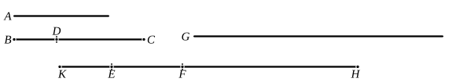

following the apotome produce, as breadths, each according to its own order, apotomes, and those following the binomial straight line themselves also, according to their order, produce the binomials as breadths,
therefore those following the apotome are different, and those following the binomial straight line are different, so that there are, in order, thirteen irrational straight lines in all,
> Medial,  
> Binomial,  
> First bimedial,  
> Second bimedial,  
> Major,  
> "Side" of a rational plus a medial area,  
> "Side" of the sum of two medial areas,  
> Apotome,  
> First apotome of a medial straight line,  
> Second apotome of a medial straight line,  
> Minor,  
> Producing with a rational area a medial whole,  
> Producing with a medial area a medial whole.  

---

### PROPOSITION 112.

*The square on a rational straight line applied to the binomial straight line produces as breadth an apotome the terms of which are commensurable with the terms of the binomial and moreover in the same ratio; and further the apotome so arising will have the same order as the binomial straight line.*

Let *A* be a rational straight line,
let *BC* be a binomial, and let *DC* be its greater term;
let the rectangle *BC*, *EF* be equal to the square on *A*;

I say that *EF* is an apotome the terms of which are commensurable with *CD*, *DB*, and in the same ratio, and further *EF* will have the same order as *BC*.
