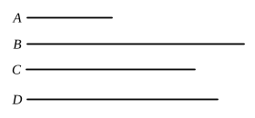

Now $\rho : \lambda'\rho = \sqrt{k}\cdot\rho : \lambda'\sqrt{k}\cdot\rho = (\rho - \sqrt{k}\cdot\rho) : (\lambda'\rho - \lambda'\sqrt{k}\cdot\rho)$, 
so that
$$(\rho - \sqrt{k}\cdot\rho) \mathbin{\cap} (\lambda'\rho - \lambda'\sqrt{k}\cdot\rho).$$
Multiplying each by $(\lambda\rho + \lambda\sqrt{k}\cdot\rho)$, we have
$$(\rho - \sqrt{k}\cdot\rho)(\lambda\rho + \lambda\sqrt{k}\cdot\rho) \mathbin{\cap} (\lambda\rho + \lambda\sqrt{k}\cdot\rho)(\lambda'\rho - \lambda'\sqrt{k}\cdot\rho)$$
$$\mathbin{\cap} \sigma^2\text{, by (1).}$$
That is, $(\rho - \sqrt{k}\cdot\rho)(\lambda\rho + \lambda\sqrt{k}\cdot\rho)$ is a rational area, 
and therefore $\sqrt{(\rho - \sqrt{k}\cdot\rho)(\lambda\rho + \lambda\sqrt{k}\cdot\rho)}$ is rational.

---

### PROPOSITION 115.

From a medial straight line there arise irrational straight 
lines infinite in number, and none of them is the same as any 
of the preceding.

Let $A$ be a medial straight line; 
I say that from $A$ there arise 
irrational straight lines infinite in 
number, and none of them is the 
same as any of the preceding.

Let a rational straight line $B$ 
be set out, 
and let the square on $C$ be equal 
to the rectangle $B$, $A$;

therefore $C$ is irrational; [X. Def. 4]

for that which is contained by an irrational and a rational 
straight line is irrational. [deduction from X. 20]

And it is not the same with any of the preceding; 
for the square on none of the preceding, if applied to a rational 
straight line produces as breadth a medial straight line.

Again, let the square on $D$ be equal to the rectangle $B$, $C$;

therefore the square on $D$ is irrational. [deduction from X. 20]

Therefore $D$ is irrational; [X. Def. 4] 
and it is not the same with any of the preceding, for the 
square on none of the preceding, if applied to a rational 
straight line, produces $C$ as breadth.

Similarly, if this arrangement proceeds *ad infinitum*, it 
is manifest that from the medial straight line there arise 
irrational straight lines infinite in number, and none is the 
same with any of the preceding.Q. E. D.

