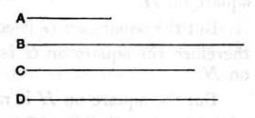

Now $\rho : \lambda'\rho = \sqrt{k}\cdot\rho : \lambda'\sqrt{k}\cdot\rho = (\rho - \sqrt{k}\cdot\rho) : (\lambda'\rho - \lambda'\sqrt{k}\cdot\rho)$,
so that
$$(\rho - \sqrt{k}\cdot\rho) \sim (\lambda'\rho - \lambda'\sqrt{k}\cdot\rho).$$
Multiplying each by $(\lambda\rho + \lambda\sqrt{k}\cdot\rho)$, we have
$$(\rho - \sqrt{k}\cdot\rho)(\lambda\rho + \lambda\sqrt{k}\cdot\rho) \sim (\lambda\rho + \lambda\sqrt{k}\cdot\rho)(\lambda'\rho - \lambda'\sqrt{k}\cdot\rho)$$
$$\sim \sigma^2 \text{, by (1).}$$
That is, $(\rho - \sqrt{k}\cdot\rho)(\lambda\rho + \lambda\sqrt{k}\cdot\rho)$ is a rational area,
and therefore $\sqrt{(\rho - \sqrt{k}\cdot\rho)(\lambda\rho + \lambda\sqrt{k}\cdot\rho)}$ is rational.

---

### PROPOSITION 115.

*From a medial straight line there arise irrational straight lines infinite in number, and none of them is the same as any of the preceding.*

Let $A$ be a medial straight line;
I say that from $A$ there arise irrational straight lines infinite in number, and none of them is the same as any of the preceding.

Let a rational straight line $B$ be set out,
and let the square on $C$ be equal to the rectangle $B$, $A$;
therefore $C$ is irrational; [x. Def. 4]
for that which is contained by an irrational and a rational straight line is irrational. [deduction from x. 20]
And it is not the same with any of the preceding;
for the square on none of the preceding, if applied to a rational straight line produces as breadth a medial straight line.
Again, let the square on $D$ be equal to the rectangle $B$, $C$;
therefore the square on $D$ is irrational. [deduction from x. 20]
Therefore $D$ is irrational; [x. Def. 4]
and it is not the same with any of the preceding, for the square on none of the preceding, if applied to a rational straight line, produces $C$ as breadth.
Similarly, if this arrangement proceeds *ad infinitum*, it is manifest that from the medial straight line there arise irrational straight lines infinite in number, and none is the same with any of the preceding.

Q. E. D.

