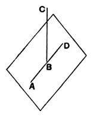

# BOOK XI. PROPOSITIONS.

### PROPOSITION 1.

*A part of a straight line cannot be in the plane of reference and a part in a plane more elevated.* [^272_1] [^272_2]

For, if possible, let a part *AB* of the straight line *ABC* be in the plane of reference, and a part *BC* in a plane more elevated.

There will then be in the plane of reference some straight line continuous with *AB* in a straight line.

Let it be *BD*;
therefore *AB* is a common segment of the two straight lines *ABC*, *ABD*:
which is impossible, inasmuch as, if we describe a circle with centre *B* and distance *AB*, the diameters will cut off unequal circumferences of the circle.

Therefore a part of a straight line cannot be in the plane of reference, and a part in a plane more elevated.

**Q. E. D.**

[^272_1]: the plane of reference, τὸ ὑποκείμενον ἐπίπεδον, the plane laid down or assumed.
[^272_2]: more elevated, μετεωροτέρῳ.

---

There is no doubt that the proofs of the first three propositions are unsatisfactory owing to the fact that Euclid is not able to make any use of his definition of a plane for the purpose of these proofs, and they really depend upon truths which can only be assumed as axiomatic. The definition of a plane as *that surface which lies evenly with the straight lines on itself*, whatever its exact meaning may be, is nowhere appealed to as a criterion to show whether a particular surface is or is not a plane. If the meaning of it is what I conjecture in the note on Book I., Def. 7 (Vol. 1. p. 171), if, namely, it only tries to express without an appeal to sight what Plato meant by the "middle covering the extremities" (*i.e.* apparently, in the case of a plane, the fact that a plane looked at edgewise takes the form of a straight line), then it is perhaps possible to connect the definition with a method of generating a plane which
