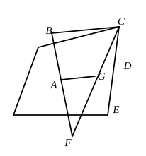
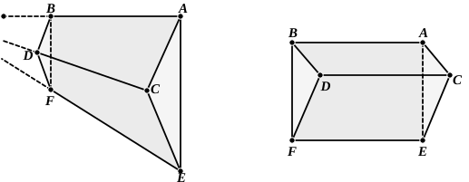

*If two planes meet in a point, they meet in a straight line.*

Let *ABC*, *ADE* be two given planes meeting at *A*.

Take any points *B*, *C* lying on the plane *ABC*, and not on the plane *ADE* but on the same side of it.

Join *AB*, *AC*, and produce *BA* to *F*.

Join *CF*.

Then, since *B*, *F* are on opposite sides of the plane *ADE*, *C*, *F* are also on opposite sides of it.

Therefore *CF* must meet the plane *ADE* in some point, say *G*.

Then, since *A*, *G* are both in each of the planes *ABC*, *ADE*, the straight line *AG* is in both planes.        [Simson's def.]

This is also the place to insert the proposition that, *If three planes intersect two and two, their lines of intersection either meet in a point or are parallel two and two.*

Let there be three planes intersecting in the straight lines *AB*, *CD*, *EF*.

Now *AB*, *EF* are in a plane; therefore they either meet in a point or are parallel.

(1) Let them meet in *O*.

Then *O*, being a point in *AB*, lies in the plane *AD*, and, being also a point in *EF*, lies also in the plane *ED*.

Therefore *O*, being common to the planes *AD*, *DE*, must lie on *CD*, the line of their intersection; i.e. *CD*, if produced, passes through *O*.

(2) Let *AB*, *EF* not meet, but let them be parallel.

Then *CD* cannot meet *AB*; for, if it did, it must necessarily meet *EF*, by the first case.

Therefore *CD*, *AB*, being in one plane, are parallel.

Similarly *CD*, *EF* are parallel.

### PROPOSITION 4.

*If a straight line be set up at right angles to two straight lines which cut one another, at their common point of section, it will also be at right angles to the plane through them.*
