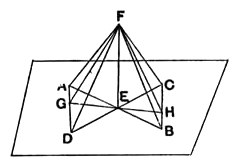

For let a straight line *EF* be set up at right angles to the two straight lines *AB*, *CD*, which cut one another at the point *E*, from *E*;
I say that *EF* is also at right angles to the plane through *AB*, *CD*.

For let *AE*, *EB*, *CE*, *ED* be cut off equal to one another, and let any straight line *GEH* be drawn across through *E*, at random; let *AD*, *CB* be joined, and further let *FA*, *FG*, *FD*, *FC*, *FH*, *FB* be joined from the point *F* taken at random <on *EF*>.

Now, since the two straight lines *AE*, *ED* are equal to the two straight lines *CE*, *EB*, and contain equal angles, [I. 15]
therefore the base *AD* is equal to the base *CB*, and the triangle *AED* will be equal to the triangle *CEB*; [I. 4]
so that the angle *DAE* is also equal to the angle *EBC*.

But the angle *AEG* is also equal to the angle *BEH*; [I. 15]
therefore *AGE*, *BEH* are two triangles which have two angles equal to two angles respectively, and one side equal to one side, namely that adjacent to the equal angles, that is to say, *AE* to *EB*;
therefore they will also have the remaining sides equal to the remaining sides.        [I. 26]

Therefore *GE* is equal to *EH*, and *AG* to *BH*.

And, since *AE* is equal to *EB*, while *FE* is common and at right angles, therefore the base *FA* is equal to the base *FB*.        [I. 4]

For the same reason *FC* is also equal to *FD*.

And, since *AD* is equal to *CB*, and *FA* is also equal to *FB*, the two sides *FA*, *AD* are equal to the two sides *FB*, *BC* respectively;
and the base *FD* was proved equal to the base *FC*;
therefore the angle *FAD* is also equal to the angle *FBC*. [I. 8]
