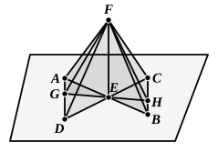

For let a straight line $EF$ be set up at right angles to the 
two straight lines $AB$, $CD$, which 
cut one another at the point $E$, 
from $E$; 
I say that $EF$ is also at right 
angles to the plane through $AB$, 
$CD$.

For let $AE$, $EB$, $CE$, $ED$ be 
cut off equal to one another, 
and let any straight line $GEH$ be drawn across through $E$, 
at random; 
let $AD$, $CB$ be joined, 
and further let $FA$, $FG$, $FD$, $FC$, $FH$, $FB$ be joined from 
the point $F$ taken at random &lt;on $EF$&gt;.

Now, since the two straight lines $AE$, $ED$ are equal to 
the two straight lines $CE$, $EB$, and contain equal angles, [I. 15]

therefore the base $AD$ is equal to the base $CB$, 
and the triangle ">$AED$ will be equal to the triangle ">$CEB$; [I. 4] 
so that the angle $DAE$ is also equal to the angle $EBC$.

But the angle $AEG$ is also equal to the angle $BEH$; [I. 15]

therefore ">$AGE$, ">$BEH$ are two triangles which have two 
angles equal to two angles respectively, and one side equal 
to one side, namely that adjacent to the equal angles, that 
is to say, $AE$ to $EB$; 
therefore they will also have the remaining sides equal to the 
remaining sides. [I. 26]

Therefore $GE$ is equal to $EH$, and $AG$ to $BH$.

And, since $AE$ is equal to $EB$, 
while $FE$ is common and at right angles,

therefore the base $FA$ is equal to the base $FB$. [I. 4]

For the same reason 
$FC$ is also equal to $FD$.

And, since $AD$ is equal to $CB$, 
and $FA$ is also equal to $FB$, 
the two sides $FA$, $AD$ are equal to the two sides $FB$, $BC$ 
respectively; 
and the base $FD$ was proved equal to the base $FC$;

therefore the angle $FAD$ is also equal to the angle $FBC$. [I. 8]

