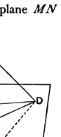
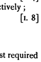

(7) triangles *FEG*, *FEH* equal in all respects,        [by (2), (6) and I. 8]
so that the angles *FEG*, *FEH* are equal,
and therefore *FE* is at right angles to *GH*.

In consequence of the length of the above proof others have been suggested, and the proof which now finds most general acceptance is that of Cauchy, which is as follows.

Let *AB* be perpendicular to two straight lines *BC*, *BD* in the plane *MN* at their point of intersection *B*.

In the plane *MN* draw *BE*, any straight line through *B*.

Join *CD*, and let *CD* meet *BE* in *E*.

Produce *AB* to *F* so that *BF* is equal to *AB*.

Join *AC*, *AE*, *AD*, *CF*, *EF*, *DF*.

Since *BC* is perpendicular to *AF* at its middle point *B*, *AC* is equal to *CF*.

Similarly *AD* is equal to *DF*.

Since in the triangles *ACD*, *FCD* the two sides *AC*, *CD* are respectively equal to the two sides *FC*, *CD*, and the third sides *AD*, *FD* are also equal,
the angles *ACD*, *FCD* are equal.        [I. 8]

The triangles *ACE*, *FCE* thus have two sides and the included angle equal, whence
*EA* is equal to *EF*.        [I. 4]

The triangles *ABE*, *FBE* have now all their sides equal respectively;
therefore the angles *ABE*, *FBE* are equal,        [I. 8]
and *AB* is perpendicular to *BE*.

And *BE* is in any straight line through *B* in the plane *MN*.

Legendre's proof is not so easy, but it is interesting.  We are first required to draw through any point *E* within the angle *CBD* a straight line *CD* bisected at *E*.

To do this we draw *EK* parallel to *DB* meeting *BC* in *K*, and then mark off *KC* equal to *BK*.

*CE* is then joined and produced to *D*; and *CD* is the straight line required.

Now, joining *AC*, *AE*, *AD* in the figure above, we have, since *CD* is bisected at *E*,
(1) in the triangle *ACD*,
$AC^2 + AD^2 = 2AE^2 + 2ED^2$,
and also (2) in the triangle *BCD*,
$BC^2 + BD^2 = 2BE^2 + 2ED^2$.

Subtracting, and remembering that the triangles *ABC*, *ABD* are right-angled, so that
$AC^2 - BC^2 = AB^2$,
and
$AD^2 - BD^2 = AB^2$,
we have
$2AB^2 = 2AE^2 - 2BE^2$,
or
$AE^2 = AB^2 + BE^2$,
