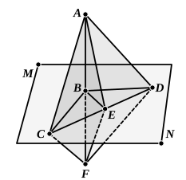
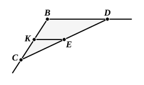

(7) triangles ">$FEG$, ">$FEH$ equal in all respects, [by (2), (6) and I. 8] 
so that the angles $FEG$, $FEH$ are equal, 
and therefore $FE$ is at right angles to $GH$.

In consequence of the length of the above proof others have been 
suggested, and the proof which now finds most general acceptance is that of 
Cauchy, which is as follows.

Let $AB$ be perpendicular to two straight lines $BC$, $BD$ in the plane ">$MN$ 
at their point of intersection $B$. 
In the plane ">$MN$ draw $BE$, any straight line 
through $B$. 
Join $CD$, and let $CD$ meet $BE$ in $E$. 
Produce $AB$ to $F$ so that $BF$ is equal to $AB$. 
Join $AC$, $AE$, $AD$, $CF$, $EF$, $DF$.

Since $BC$ is perpendicular to $AF$ at its 
middle point $B$,

$AC$ is equal to $CF$.

Similarly $AD$ is equal to $DF$.

Since in the triangles ">$ACD$, ">$FCD$ the two 
sides $AC$, $CD$ are respectively equal to the two 
sides $FC$, $CD$, and the third sides $AD$, $FD$ are 
also equal,

the angles $ACD$, $FCD$ are equal. [I. 8]

The triangles ">$ACE$, ">$FCE$ thus have two sides and the included angle 
equal, whence

$EA$ is equal to $EF$. [I. 4]

The triangles ">$ABE$, ">$FBE$ have now all their sides equal respectively; 

therefore the angles $ABE$, $FBE$ are equal, [I. 8] 
and $AB$ is perpendicular to $BE$.

And $BE$ is in any straight line through $B$ in the plane ">$MN$.

Legendre's proof is not so easy, but it is interesting.  We are first required 
to draw through any point $E$ within the angle 
$CBD$ a straight line $CD$ bisected at $E$. 
To do this we draw $EK$ parallel to $DB$ 
meeting $BC$ in $K$, and then mark off $KC$ equal 
to $BK$. 
$CE$ is then joined and produced to $D$; and 
$CD$ is the straight line required.

Now, joining $AC$, $AE$, $AD$ in the figure 
above, we have, since $CD$ is bisected at $E$, 
(1) in the triangle ">$ACD$,

$AC^2$ $+$ $AD^2$ $= 2$$AE^2$ $+ 2$$ED^2$,

and also (2) in the triangle ">$BCD$,

$BC^2$ $+$ $BD^2$ $= 2$$BE^2$ $+ 2$$ED^2$.

Subtracting, and remembering that the triangles ">$ABC$, ">$ABD$ are right- 
angled, so that

$AC^2$ $-$ $BC^2$ $=$ $AB^2$,

and

$AD^2$ $-$ $BD^2$ $=$ $AB^2$,

we have

$2$$AB^2$ $= 2$$AE^2$ $- 2$$BE^2$,

or

$AE^2$ $=$ $AB^2$ $+$ $BE^2$,

