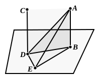

(1) it would intersect $AB$ at $O$ but not pass through $OQ$, or
(2) it would intersect $AB$ at a point different from $O$.
    In either case, an absurdity would result.

---

### PROPOSITION 6.

*If two straight lines be at right angles to the same plane, the straight lines will be parallel.*

For let the two straight lines $AB$, $CD$ be at right angles to the plane of reference;
I say that $AB$ is parallel to $CD$.

For let them meet the plane of reference at the points $B$, $D$,
let the straight line $BD$ be joined,
let $DE$ be drawn, in the plane of reference, at right angles to $BD$,
let $DE$ be made equal to $AB$,
and let $BE$, $AE$, $AD$ be joined.

Now, since $AB$ is at right angles to the plane of reference,
it will also make right angles with all the straight lines which meet it and are in the plane of reference.            [XI. Def. 3]

But each of the straight lines $BD$, $BE$ is in the plane of reference and meets $AB$;
therefore each of the angles $ABD$, $ABE$ is right.

For the same reason
each of the angles $CDB$, $CDE$ is also right.

And, since $AB$ is equal to $DE$,
and $BD$ is common,
the two sides $AB$, $BD$ are equal to the two sides $ED$, $DB$;
and they include right angles;
therefore the base $AD$ is equal to the base $BE$.            [I. 4]

And, since $AB$ is equal to $DE$,
while $AD$ is also equal to $BE$,
the two sides $AB$, $BE$ are equal to the two sides $ED$, $DA$;
and $AE$ is their common base;
therefore the angle $ABE$ is equal to the angle $EDA$.            [I. 8]
