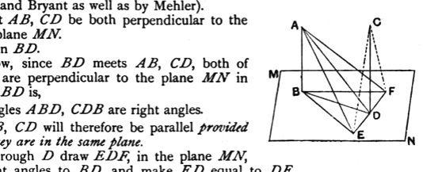

But the angle $ABE$ is right;
therefore the angle $EDA$ is also right;
therefore $ED$ is at right angles to $DA$.

But it is also at right angles to each of the straight lines $BD$, $DC$;
therefore $ED$ is set up at right angles to the three straight lines $BD$, $DA$, $DC$ at their point of meeting;
therefore the three straight lines $BD$, $DA$, $DC$ are in one plane.            [XI. 5]

But, in whatever plane $DB$, $DA$ are, in that plane is $AB$ also,
for every triangle is in one plane;            [XI. 2]
therefore the straight lines $AB$, $BD$, $DC$ are in one plane.

And each of the angles $ABD$, $BDC$ is right;
therefore $AB$ is parallel to $CD$.            [I. 28]

Therefore etc.

Q. E. D.

---

If anyone wishes to convince himself of the real necessity for some general agreement as to the order in which propositions in elementary geometry should be taken, let him contemplate the hopeless result of too much independence on the part of editors in the matter of this proposition and its converse, XI. 8.

Legendre adopts a different, and elegant, method of proof; but he applies it to XI. 8, which he gives first, and then deduces XI. 6 from it by *reductio ad absurdum*. Dr Mehler uses Legendre's method of proof but applies it to XI. 6, and then gives XI. 8 as a deduction from it. Lardner follows Legendre. Holgate, the editor of a recent American book, gives Euclid's proof of XI. 6 and deduces XI. 8 by *reductio ad absurdum*. His countrymen, Schultze and Sevenoak, give XI. 8 first, but put it after, and deduce it from, Eucl. XI. 10; they then give XI. 6, practically as a deduction from XI. 8 by *reductio ad absurdum*, after a proposition corresponding to Eucl. XI. 11 and 12, and a corollary to the effect that through a given point one and only one perpendicular can be drawn to a given plane.

We will now give the proof of XI. 6 by Legendre's method (adopted by Smith and Bryant as well as by Mehler).

Let $AB$, $CD$ be both perpendicular to the same plane $MN$.

Join $BD$.

Now, since $BD$ meets $AB$, $CD$, both of which are perpendicular to the plane $MN$ in which $BD$ is,
the angles $ABD$, $CDB$ are right angles.

$AB$, $CD$ will therefore be parallel *provided that they are in the same plane*.

Through $D$ draw $EDF$, in the plane $MN$, at right angles to $BD$, and make $ED$ equal to $DF$.
