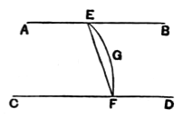

Join $BE$, $BF$, $AE$, $AD$, $AF$.

Then the triangles $BDE$, $BDF$ are equal in all respects (by I. 4), so that
$$BE \text{ is equal to } BF.$$

It follows, since the angles $ABE$, $ABF$ are right, that the triangles $ABE$, $ABF$ are equal in all respects, and
$$AE \text{ is equal to } AF.$$

[Mehler now argues elegantly thus. If $CE$, $CF$ be also joined, it is clear that
$$CE \text{ is equal to } CF.$$

Hence each of the four points $A$, $B$, $C$, $D$ is equidistant from the two points $E$, $F$.

*Therefore the points* A, B, C, D *are in one plane*, so that $AB$, $CD$ are parallel.

If, however, we do not use the locus of points equidistant from two fixed points, we proceed as follows.]

The triangles $AED$, $AFD$ have their sides equal respectively;
hence [I. 8] the angles $ADE$, $ADF$ are equal,
so that $ED$ is at right angles to $AD$.

Thus $ED$ is at right angles to $BD$, $AD$, $CD$;
therefore $CD$ is in the plane through $AD$, $BD$.            [XI. 5]

But $AB$ is in that same plane;            [XI. 2]
therefore $AB$, $CD$ are in the same plane.

And the angles $ABD$, $CDB$ are right;
therefore $AB$, $CD$ are parallel.

---

### PROPOSITION 7.

*If two straight lines be parallel and points be taken at random on each of them, the straight line joining the points is in the same plane with the parallel straight lines.*

Let $AB$, $CD$ be two parallel straight lines,
and let points $E$, $F$ be taken at random on them respectively;
I say that the straight line joining the points $E$, $F$ is in the same plane with the parallel straight lines.

For suppose it is not, but, if possible, let it be in a more elevated plane as $EGF$,
and let a plane be drawn through $EGF$;
it will then make, as section in the plane of reference, a straight line.            [XI. 3]
