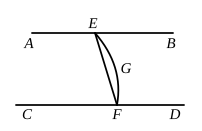

Join $BE$, $BF$, $AE$, $AD$, $AF$. 
Then the triangles ">$BDE$, ">$BDF$ are equal in all respects (by I. 4), so that

$BE$ is equal to $BF$.

It follows, since the angles $ABE$, $ABF$ are right, that the triangles ">$ABE$, 
">$ABF$ are equal in all respects, and

$AE$ is equal to $AF$.

[Mehler now argues elegantly thus. If $CE$, $CF$ be also joined, it is clear 
that

$CE$ is equal to $CF$.

Hence each of the four points $A$, $B$, $C$, $D$ is equidistant from the two 
points $E$, $F$. 
*Therefore the points* $A$, $B$, $C$, $D$ *are in one plane*, so that $AB$, $CD$ are 
parallel. 
If, however, we do not use the locus of points equidistant from two fixed 
points, we proceed as follows.]

The triangles ">$AED$, ">$AFD$ have their sides equal respectively; 
hence [I. 8] the angles $ADE$, $ADF$ are equal, 
so that $ED$ is at right angles to $AD$.

Thus $ED$ is at right angles to $BD$, $AD$, $CD$; 
therefore $CD$ is in the plane through $AD$, $BD$. [XI. 5]

But $AB$ is in that same plane; [XI. 2] 
therefore $AB$, $CD$ are in the same plane.

And the angles $ABD$, $CDB$ are right; 
therefore $AB$, $CD$ are parallel.

---

### PROPOSITION 7.

If two straight lines be parallel and points be taken at 
random on each of them, the straight line joining the points is 
in the same plane with the parallel straight lines.

Let $AB$, $CD$ be two parallel straight lines, 
and let points $E$, $F$ be taken at random 
on them respectively; 
I say that the straight line joining the 
points $E$, $F$ is in the same plane with 
the parallel straight lines.

For suppose it is not, but, if possible, 
let it be in a more elevated plane as 
$EGF$, 
and let a plane be drawn through $EGF$;

it will then make, as section in the plane of reference, a 
straight line. [XI. 3]

