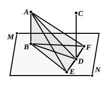

so that *CD* is also at right angles to the plane through *DE*, *DB*. [XI. 4]
    But the plane through *DE*, *DB* is the plane of reference; therefore *CD* is at right angles to the plane of reference.
    Therefore etc.

Q. E. D.

---

Simson objects to the words which explain why *DC* is in the plane through *BD*, *DA*, viz. "inasmuch as *AB*, *BD* are in the plane through *BD*, *DA*, and *DC* is also in the plane in which *AB*, *BD* are," as being too roundabout. He concludes that they are corrupt or interpolated, and that we ought only to have the words "because all three are in the plane in which are the parallels *AB*, *CD*" (by Prop. 7 preceding). But I think Euclid's words can be defended. Prop. 7 says nothing of a plane determined by *two* transversals as *BD*, *DA* are. Hence it is natural to say that *DC* is in the same plane in which *AB*, *BD* are [Prop. 7], and *AB*, *BD* are in the same plane as *BD*, *DA* [Prop. 2], so that *DC* is in the plane through *BD*, *DA*.

Legendre's alternative proof is split by him into two propositions.
(1) *Let AB be a perpendicular to the plane MN and EF a line situated in that plane; if from B, the foot of the perpendicular, BD be drawn perpendicular to EF, and AD be joined, I say that AD will be perpendicular to EF.*
(2) *If AB is perpendicular to the plane MN, every straight line CD parallel to AB will be perpendicular to the same plane.*

To prove both propositions together we suppose *CD* given, join *BD*, and draw *EF* perpendicular to *BD* in the plane *MN*.

(1) As before, we make *DE* equal to *DF* and join *BE*, *BF*, *AE*, *AF*.
    Then, since the angles *BDE*, *BDF* are right, and *DE*, *DF* equal,
        *BE* is equal to *BF*. [I. 4]
    And, since *AB* is perpendicular to the plane,
        the angles *ABE*, *ABF* are both right.
    Therefore, in the triangles *ABE*, *ABF*,
        *AE* is equal to *AF*. [I. 4]
    Lastly, in the triangles *ADE*, *ADF*, since *AE* is equal to *AF*, and *DE* to *DF*, while *AD* is common,
        the angle *ADE* is equal to the angle *ADF*, [I. 8]
so that *AD* is perpendicular to *EF*.
(2) *ED* being thus perpendicular to *DA*, and also (by construction) perpendicular to *DB*,
        *ED* is perpendicular to the plane *ADB*. [XI. 4]
    But *CD*, being parallel to *AB*, is in the plane *ADB*;
therefore *ED* is perpendicular to *CD*. [XI. Def. 3]
