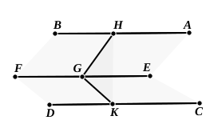

Also, since $AB$, $CD$ are parallel, 
and $ABD$ is a right angle,

$CDB$ is also a right angle. 
Thus $CD$ is perpendicular to both $DE$ and $DB$, and therefore to the 
plane ">$MN$ through $DE$, $DB$.

---

### PROPOSITION 9.

Straight lines which are parallel to the same straight line 
and are not in the same plane with it are also parallel to one 
another.

For let each of the straight lines $AB$, $CD$ be parallel to 
$EF$, not being in the same plane 
with it; 
I say that $AB$ is parallel to $CD$.

For let a point $G$ be taken at 
random on $EF$, 
and from it let there be drawn 
$GH$, in the plane through $EF$, 
$AB$, at right angles to $EF$, and $GK$ in the plane through 
$FE$, $CD$ again at right angles to $EF$.

Now, since $EF$ is at right angles to each of the straight 
lines $GH$, $GK$,

therefore $EF$ is also at right angles to the plane through 
$GH$, $GK$. [XI. 4]

And $EF$ is parallel to $AB$;

therefore $AB$ is also at right angles to the plane through 
$HG$, $GK$. [XI. 8]

For the same reason 
$CD$ is also at right angles to the plane through $HG$, $GK$;

therefore each of the straight lines $AB$, $CD$ is at right angles 
to the plane through $HG$, $GK$.

But, if two straight lines be at right angles to the same 
plane, the straight lines are parallel; [XI. 6]

therefore $AB$ is parallel to $CD$.

