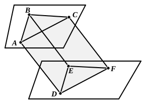

### PROPOSITION 10.

*If two straight lines meeting one another be parallel to two straight lines meeting one another not in the same plane, they will contain equal angles.*

For let the two straight lines $AB$, $BC$ meeting one another be parallel to the two straight lines $DE$, $EF$ meeting one another, not in the same plane;
I say that the angle $ABC$ is equal to the angle $DEF$.

    For let $BA$, $BC$, $ED$, $EF$ be cut off equal to one another, and let $AD$, $CF$, $BE$, $AC$, $DF$ be joined.
    Now, since $BA$ is equal and parallel to $ED$,
therefore $AD$ is also equal and parallel to $BE$. [I. 33]
    For the same reason
$CF$ is also equal and parallel to $BE$.
    Therefore each of the straight lines $AD$, $CF$ is equal and parallel to $BE$.
    But straight lines which are parallel to the same straight line and are not in the same plane with it are parallel to one another; [XI. 9]
therefore $AD$ is parallel and equal to $CF$.
    And $AC$, $DF$ join them;
therefore $AC$ is also equal and parallel to $DF$. [I. 33]
    Now, since the two sides $AB$, $BC$ are equal to the two sides $DE$, $EF$,
and the base $AC$ is equal to the base $DF$,
therefore the angle $ABC$ is equal to the angle $DEF$. [I. 8]
    Therefore etc.

Q. E. D.

