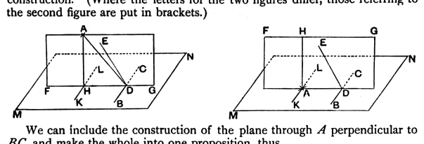

Therefore *GH* is also at right angles to all the straight lines which meet it and are in the plane through *ED*, *DA*. [XI. Def. 3]
    But *AF* meets it and is in the plane through *ED*, *DA*;
therefore *GH* is at right angles to *FA*,
so that *FA* is also at right angles to *GH*.
    But *AF* is also at right angles to *DE*;
therefore *AF* is at right angles to each of the straight lines *GH*, *DE*.
    But, if a straight line be set up at right angles to two straight lines which cut one another, at the point of section, it will also be at right angles to the plane through them; [XI. 4]
therefore *FA* is at right angles to the plane through *ED*, *GH*.
    But the plane through *ED*, *GH* is the plane of reference;
therefore *AF* is at right angles to the plane of reference.
    Therefore from the given elevated point *A* the straight line *AF* has been drawn perpendicular to the plane of reference.

Q. E. F.

---

The text-books differ in the *form* which they give to this proposition rather than in substance. They commonly assume the construction of a *plane* through the point *A* at right angles to any straight line *BC* in the given plane (the construction being effected in the manner shown at the end of the note on XI. 5 above). The advantage of this method is that it enables a perpendicular to be drawn from a point *in* the plane also, by the same construction. (Where the letters for the two figures differ, those referring to the second figure are put in brackets.)

We can include the construction of the plane through *A* perpendicular to *BC*, and make the whole into one proposition, thus.
    *BC* being any straight line in the given plane *MN*, draw *AD* perpendicular to *BC*.
    In any plane passing through *BC* but not through *A* draw *DE* at right angles to *BC*.
    Through *DA*, *DE* draw a plane; this will intersect the given plane *MN* in a straight line, as *FD* (*AD*).
    In the plane *AG* draw *AH* perpendicular to *FG* (*AD*).
    Then *AH* is the perpendicular required.
