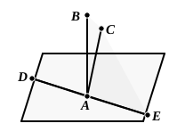

### PROPOSITION 13.

*From the same point two straight lines cannot be set up at right angles to the same plane on the same side.*

For, if possible, from the same point *A* let the two straight lines *AB*, *AC* be set up at right angles to the plane of reference and on the same side,
and let a plane be drawn through *BA*, *AC*;
it will then make, as section through *A* in the plane of reference, a straight line. [XI. 3]

    Let it make *DAE*;
therefore the straight lines *AB*, *AC*, *DAE* are in one plane.
    And, since *CA* is at right angles to the plane of reference,
it will also make right angles with all the straight lines which meet it and are in the plane of reference. [XI. Def. 3]
    But *DAE* meets it and is in the plane of reference;
therefore the angle *CAE* is right.
    For the same reason
the angle *BAE* is also right;
therefore the angle *CAE* is equal to the angle *BAE*.
    And they are in one plane:
which is impossible.
    Therefore etc.

Q. E. D.

---

Simson added words to this as follows:
    "Also, from a point above a plane there can be but one perpendicular to that plane; for, if there could be two, they would be parallel to one another [XI. 6], which is absurd."
    Euclid does not give this result, but we have already had it in the note above to XI. 4 (*ad fin.*).
