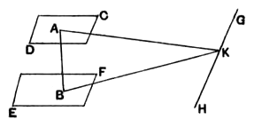

### PROPOSITION 14.

*Planes to which the same straight line is at right angles will be parallel.*

For let any straight line $AB$ be at right angles to each of the planes $CD$, $EF$;
I say that the planes are parallel.

For, if not, they will meet when produced.
Let them meet;
they will then make, as common section, a straight line. [XI. 3]
Let them make $GH$;
let a point $K$ be taken at random on $GH$,
and let $AK$, $BK$ be joined.

Now, since $AB$ is at right angles to the plane $EF$,
therefore $AB$ is also at right angles to $BK$ which is a straight line in the plane $EF$ produced; [XI. Def. 3]
therefore the angle $ABK$ is right.

For the same reason
the angle $BAK$ is also right.

Thus, in the triangle $ABK$, the two angles $ABK$, $BAK$ are equal to two right angles:
which is impossible. [I. 17]

Therefore the planes $CD$, $EF$ will not meet when produced;
therefore the planes $CD$, $EF$ are parallel. [XI. Def. 8]

Therefore planes to which the same straight line is at right angles are parallel.

Q. E. D.
