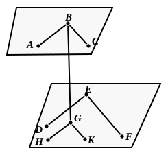

### PROPOSITION 15.

*If two straight lines meeting one another be parallel to two straight lines meeting one another, not being in the same plane, the planes through them are parallel.*

For let the two straight lines $AB$, $BC$ meeting one another be parallel to the two straight lines $DE$, $EF$ meeting one another, not being in the same plane;
I say that the planes produced through $AB$, $BC$ and $DE$, $EF$ will not meet one another.

For let $BG$ be drawn from the point $B$ perpendicular to the plane through $DE$, $EF$ [XI. 11], and let it meet the plane at the point $G$;
through $G$ let $GH$ be drawn parallel to $ED$, and $GK$ parallel to $EF$. [I. 31]

Now, since $BG$ is at right angles to the plane through $DE$, $EF$,
therefore it will also make right angles with all the straight lines which meet it and are in the plane through $DE$, $EF$. [XI. Def. 3]

But each of the straight lines $GH$, $GK$ meets it and is in the plane through $DE$, $EF$;
therefore each of the angles $BGH$, $BGK$ is right.

And, since $BA$ is parallel to $GH$, [XI. 9]
therefore the angles $GBA$, $BGH$ are equal to two right angles. [I. 29]

But the angle $BGH$ is right;
therefore the angle $GBA$ is also right;
therefore $GB$ is at right angles to $BA$.

For the same reason
$GB$ is also at right angles to $BC$.

Since then the straight line $GB$ is set up at right angles to the two straight lines $BA$, $BC$ which cut one another,
therefore $GB$ is also at right angles to the plane through $BA$, $BC$. [XI. 4]
