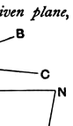
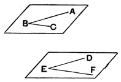
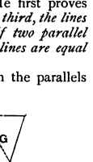

5. *If each of two intersecting straight lines is parallel to a given plane, the plane containing them is parallel to the given plane.*

Let $AB$, $AC$ be parallel to the plane $MN$.
Then, if the plane $ABC$ were to meet the plane $MN$, the intersection would be parallel both to $AB$ and to $AC$: which is impossible.

Lastly, we have Euclid's proposition.

6. *If two straight lines forming an angle are respectively parallel to two other straight lines forming an angle, the plane of the first angle is parallel to the plane of the second.*

Let $ABC$, $DEF$ be the angles formed by straight lines parallel to one another respectively.
Then, since $AB$ is parallel to $DE$, the plane of $DEF$ is parallel to $AB$ [(1) above].
Similarly the plane of $DEF$ is parallel to $BC$.
Hence the plane of $DEF$ is parallel to the plane of $ABC$ [(5)].

Legendre arrives at the result by yet another method. He first proves Eucl. XI. 16 to the effect that, *if two parallel planes are cut by a third, the lines of intersection are parallel*, and then deduces from this that, *if two parallel straight lines are terminated by two parallel planes, the straight lines are equal in length*.
(The latter inference is obvious because the plane through the parallels cuts the parallel planes in parallel lines; which therefore, with the given parallel lines, form a parallelogram.)

Legendre is now in a position to prove Euclid's proposition XI. 15.
If $ABC$, $DEF$ be the angles, make $AB$ equal to $DE$, and $BC$ equal to $EF$, and join $CA$, $FD$, $BE$, $CF$, $AD$.
Then, as in Eucl. XI. 10, the triangles $ABC$, $DEF$ are equal in all respects;
and $AD$, $BE$, $CF$ are all equal.
It is now proved that the planes are parallel by *reductio ad absurdum* from the last preceding result. For, if the plane $ABC$ is not parallel to the plane $DEF$, let the plane drawn through $B$ parallel to the plane $DEF$ meet $CF$, $AD$ in $H$, $G$ respectively.
Then, by the last result $BE$, $HF$, $GD$ will all be equal.
But $BE$, $CF$, $AD$ are all equal:
which is impossible.
Therefore etc.

