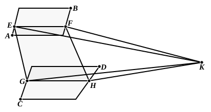

### PROPOSITION 16.

*If two parallel planes be cut by any plane, their common sections are parallel.*

For let the two parallel planes ">$AB$, ">$CD$ be cut by the plane ">$EFGH$,
and let $EF$, $GH$ be their common sections;
I say that $EF$ is parallel to $GH$.

For, if not, $EF$, $GH$ will, when produced, meet either in the direction of $F$, $H$ or of $E$, $G$.
Let them be produced, as in the direction of $F$, $H$, and let them, first, meet at $K$.

Now, since $EFK$ is in the plane ">$AB$,
therefore all the points on $EFK$ are also in the plane ">$AB$. [XI. 1]

But $K$ is one of the points on the straight line $EFK$;
therefore $K$ is in the plane ">$AB$.

For the same reason
$K$ is also in the plane ">$CD$;
therefore the planes ">$AB$, ">$CD$ will meet when produced.

But they do not meet, because they are, by hypothesis, parallel;
therefore the straight lines $EF$, $GH$ will not meet when produced in the direction of $F$, $H$.

Similarly we can prove that neither will the straight lines $EF$, $GH$ meet when produced in the direction of $E$, $G$.

But straight lines which do not meet in either direction are parallel. [I. Def. 23]

Therefore $EF$ is parallel to $GH$.

Therefore etc.

Q. E. D.
