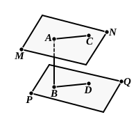

Simson points out that, in here quoting I. Def. 23, Euclid should have 
said “But straight lines *in one plane* which do not meet in either direction are 
parallel.”

From this proposition is deduced the converse of XI. 14.

*If a straight line is perpendicular to one of two parallel planes, it is* 
*perpendicular to the other also.*

For suppose that ">$MN$, ">$PQ$ are two parallel planes, and that $AB$ is perpen- 
dicular to ">$MN$. 
Through $AB$ draw any plane, and let it intersect 
the planes ">$MN$, ">$PQ$ in $AC$, $BD$ respectively. 
Therefore $AC$, $BD$ are parallel. [XI. 16] 
But $AC$ is perpendicular to $AB$ ; 
therefore $AB$ is also perpendicular to $BD$. 
That is, $AB$ is perpendicular to any line in ">$PQ$ 
passing through $B$ ; 
therefore $AB$ is perpendicular to ">$PQ$.

It follows as a corollary that

*Through a given point one plane, and only one, can be drawn parallel to a* 
*given plane.*

In the above figure let $A$ be the given point and ">$PQ$ the given plane. 
Draw $AB$ perpendicular to ">$PQ$. 
Through $A$ draw a plane ">$MN$ at right angles to $AB$ (see note on XI. 5 
above). 
Then ">$MN$ is parallel to ">$PQ$. [XI. 14] 
If there could pass through $A$ a second plane parallel to ">$PQ$, $AB$ would 
also be perpendicular to it. 
That is, $AB$ would be perpendicular to two different planes through $A$ : 
which is impossible (see the same note).

Also it is readily proved that,

*If two planes are parallel to a third plane, they are parallel to one another.*

---

### PROPOSITION 17.

If two straight lines be cut by parallel planes, they will be 
cut in the same ratios.

For let the two straight 
lines $AB$, $CD$ be cut by the 
parallel planes ">$GH$, ">$KL$, ">$MN$ 
at the points $A$, $E$, $B$ and $C$, 
$F$, $D$; 
I say that, as the straight line 
$AE$ is to $EB$, so is $CF$ to $FD$.

For let $AC$, $BD$, $AD$ be 
joined, 
let $AD$ meet the plane ">$KL$ 
at the point $O$, 
and let $EO$, $OF$ be joined.
