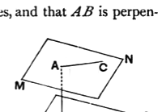
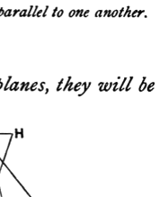

Simson points out that, in here quoting I. Def. 23, Euclid should have said "But straight lines *in one plane* which do not meet in either direction are parallel."

From this proposition is deduced the converse of XI. 14.

*If a straight line is perpendicular to one of two parallel planes, it is perpendicular to the other also.*

For suppose that $MN$, $PQ$ are two parallel planes, and that $AB$ is perpendicular to $MN$.

Through $AB$ draw any plane, and let it intersect the planes $MN$, $PQ$ in $AC$, $BD$ respectively.
Therefore $AC$, $BD$ are parallel. [XI. 16]
But $AC$ is perpendicular to $AB$;
therefore $AB$ is also perpendicular to $BD$.

That is, $AB$ is perpendicular to any line in $PQ$ passing through $B$;
therefore $AB$ is perpendicular to $PQ$.

It follows as a corollary that

*Through a given point one plane, and only one, can be drawn parallel to a given plane.*

In the above figure let $A$ be the given point and $PQ$ the given plane.
Draw $AB$ perpendicular to $PQ$.
Through $A$ draw a plane $MN$ at right angles to $AB$ (see note on XI. 5 above).
Then $MN$ is parallel to $PQ$. [XI. 14]
If there could pass through $A$ a second plane parallel to $PQ$, $AB$ would also be perpendicular to it.
That is, $AB$ would be perpendicular to two different planes through $A$: which is impossible (see the same note).

Also it is readily proved that,

*If two planes are parallel to a third plane, they are parallel to one another.*

---

### PROPOSITION 17.

*If two straight lines be cut by parallel planes, they will be cut in the same ratios.*

For let the two straight lines $AB$, $CD$ be cut by the parallel planes $GH$, $KL$, $MN$ at the points $A$, $E$, $B$ and $C$, $F$, $D$;
I say that, as the straight line $AE$ is to $EB$, so is $CF$ to $FD$.

For let $AC$, $BD$, $AD$ be joined,
let $AD$ meet the plane $KL$ at the point $O$,
and let $EO$, $OF$ be joined.
