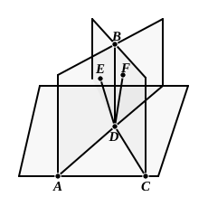

Then $ABF$ is the angle which Euclid calls (in the case where it is acute) the "inclination of the plane to the plane."

But, since $AB$ is perpendicular to the plane ">$MN$, it is perpendicular to $BF$ in it.

Therefore the angle $ABF$ is a right angle;
whence the plane ">$CE$ is perpendicular to the plane ">$MN$.

---

### PROPOSITION 19.

*If two planes which cut one another be at right angles to any plane, their common section will also be at right angles to the same plane.*

For let the two planes ">$AB$, ">$BC$ be at right angles to the plane of reference,
and let $BD$ be their common section;
I say that $BD$ is at right angles to the plane of reference.

For suppose it is not, and from the point $D$ let $DE$ be drawn in the plane ">$AB$ at right angles to the straight line $AD$, and $DF$ in the plane ">$BC$ at right angles to $CD$.

Now, since the plane ">$AB$ is at right angles to the plane of reference,
and $DE$ has been drawn in the plane ">$AB$ at right angles to $AD$, their common section,
therefore $DE$ is at right angles to the plane of reference.
[XI. Def. 4]
