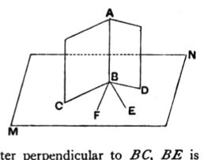

Similarly we can prove that
*DF* is also at right angles to the plane of reference.

Therefore from the same point *D* two straight lines have been set up at right angles to the plane of reference on the same side:
which is impossible.
[XI. 13]

Therefore no straight line except the common section *DB* of the planes *AB*, *BC* can be set up from the point *D* at right angles to the plane of reference.

Therefore etc.

Q. E. D.

---

Legendre, followed by other writers already quoted, uses a preliminary proposition equivalent to Euclid's definition of planes at right angles to one another.

*If two planes are perpendicular to one another, a straight line drawn in one of them perpendicular to their common section will be perpendicular to the other.*

Let the perpendicular planes *CE*, *MN* (figure of last note) intersect in *CD*, and let *AB* be drawn in *CE* perpendicular to *CD*.

In the plane *MN* draw *BF* at right angles to *CD*.

Then, since the planes are perpendicular, the angle *ABF* (their inclination) is a right angle.

Therefore *AB* is perpendicular to both *CD* and *BF*, and therefore to the plane *MN*.

We are now in a position to prove XI. 19, viz. *If two planes be perpendicular to a third, their intersection is also perpendicular to that third plane.*

Let each of the two planes *AC*, *AD* intersecting in *AB* be perpendicular to the plane *MN*.

Let *AC*, *AD* intersect *MN* in *BC*, *BD* respectively.

In the plane *MN* draw *BE* at right angles to *BC* and *BF* at right angles to *BD*.

Now, since the planes *AC*, *MN* are at right angles, and *BE* is drawn in the latter perpendicular to *BC*, *BE* is perpendicular to the plane *AC*.
[XI. 4]
Hence *AB* is perpendicular to *BE*.

Similarly *AB* is perpendicular to *BF*.

Therefore *AB* is perpendicular to the plane through *BE*, *BF*, i.e. to the plane *MN*.

An useful problem is that of drawing a common perpendicular to two straight lines not in one plane, and in connexion with this the following proposition may be given.
