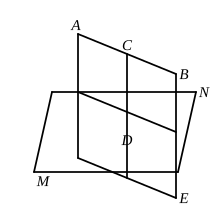

*Given a plane and a straight line not perpendicular to it, one plane, and only one, can be drawn through the straight line perpendicular to the plane.*

Let $AB$ be the given straight line, ">$MN$ the given plane.

From any point $C$ in $AB$ draw $CD$ perpendicular to the plane ">$MN$.

Through $AB$ and $CD$ draw a plane ">$AE$.

Then the plane ">$AE$ is perpendicular to the plane ">$MN$.
[XI. 18]

If any other plane could be drawn through $AB$ perpendicular to ">$MN$, the intersection $AB$ of the two planes perpendicular to ">$MN$ would itself be perpendicular to ">$MN$:
[XI. 19]
which contradicts the hypothesis.

*To draw a common perpendicular to two straight lines not in the same plane.*

Let $AB$, $CD$ be the given straight lines.

Through $CD$ draw the plane ">$MN$ parallel to $AB$ (Prop. 2 in note to XI. 15).

Through $AB$ draw the plane ">$AF$ perpendicular to the plane ">$MN$ (see the last preceding proposition).

Let the planes ">$AF$, ">$MN$ intersect in $EF$, and let $EF$ meet $CD$ in $G$.

From $G$, in the plane ">$AF$, draw $GH$ at right angles to $EF$, meeting $AB$ in $H$.

$GH$ is then the required perpendicular.

For $AB$ is parallel to $EF$ (Prop. 4 in note to XI. 15); therefore $GH$, being perpendicular to $EF$, is also perpendicular to $AB$.

But, the plane ">$AF$ being perpendicular to the plane ">$MN$, and $GH$ being perpendicular to $EF$, their intersection,
$GH$ is perpendicular to the plane ">$MN$, and therefore to $CD$.

Therefore $GH$ is perpendicular to both $AB$ and $CD$.

*Only one common perpendicular can be drawn to two straight lines not in one plane.*

For, if possible, let $KL$ also be perpendicular to both $AB$ and $CD$.

Let the plane through $KL$, $AB$ meet the plane ">$MN$ in $LQ$.

Then $AB$ is parallel to $LQ$ (Prop. 4 in note to XI. 15), so that $KL$, being perpendicular to $AB$, is also perpendicular to $LQ$.

Therefore $KL$ is perpendicular to both $CL$ and $LQ$, and consequently to the plane ">$MN$.

But, if $KP$ be drawn in the plane ">$AF$ perpendicular to $EF$, $KP$ is also perpendicular to the plane ">$MN$.
