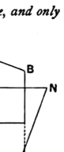
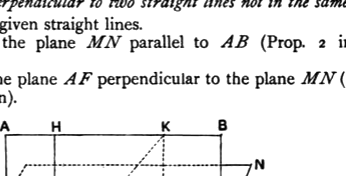

*Given a plane and a straight line not perpendicular to it, one plane, and only one, can be drawn through the straight line perpendicular to the plane.*

Let *AB* be the given straight line, *MN* the given plane.

From any point *C* in *AB* draw *CD* perpendicular to the plane *MN*.

Through *AB* and *CD* draw a plane *AE*.

Then the plane *AE* is perpendicular to the plane *MN*.
[XI. 18]

If any other plane could be drawn through *AB* perpendicular to *MN*, the intersection *AB* of the two planes perpendicular to *MN* would itself be perpendicular to *MN*:
[XI. 19]
which contradicts the hypothesis.

*To draw a common perpendicular to two straight lines not in the same plane.*

Let *AB*, *CD* be the given straight lines.

Through *CD* draw the plane *MN* parallel to *AB* (Prop. 2 in note to XI. 15).

Through *AB* draw the plane *AF* perpendicular to the plane *MN* (see the last preceding proposition).

Let the planes *AF*, *MN* intersect in *EF*, and let *EF* meet *CD* in *G*.

From *G*, in the plane *AF*, draw *GH* at right angles to *EF*, meeting *AB* in *H*.

*GH* is then the required perpendicular.

For *AB* is parallel to *EF* (Prop. 4 in note to XI. 15); therefore *GH*, being perpendicular to *EF*, is also perpendicular to *AB*.

But, the plane *AF* being perpendicular to the plane *MN*, and *GH* being perpendicular to *EF*, their intersection,
*GH* is perpendicular to the plane *MN*, and therefore to *CD*.

Therefore *GH* is perpendicular to both *AB* and *CD*.

*Only one common perpendicular can be drawn to two straight lines not in one plane.*

For, if possible, let *KL* also be perpendicular to both *AB* and *CD*.

Let the plane through *KL*, *AB* meet the plane *MN* in *LQ*.

Then *AB* is parallel to *LQ* (Prop. 4 in note to XI. 15), so that *KL*, being perpendicular to *AB*, is also perpendicular to *LQ*.

Therefore *KL* is perpendicular to both *CL* and *LQ*, and consequently to the plane *MN*.

But, if *KP* be drawn in the plane *AF* perpendicular to *EF*, *KP* is also perpendicular to the plane *MN*.
