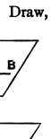
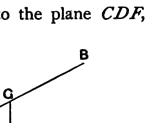
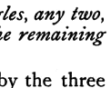

Thus there are two perpendiculars from the point *K* to the plane *MN*:
which is impossible.

Rausenberger's construction for the same problem is more elegant. Draw, he says, through each straight line a plane parallel to the other. Then draw through each straight line a plane perpendicular to the plane through the other. The two planes last drawn will intersect in a straight line, and this straight line is the common perpendicular required.

The form of the construction best suited for examination purposes, because the most self-contained, is doubtless that given by Smith and Bryant.

Let *AB*, *CD* be the two given straight lines.

Through any point *E* in *CD* draw *EF* parallel to *AB*.

From any point *G* in *AB* draw *GH* perpendicular to the plane *CDF*, meeting the plane in *H*.

Through *H* in the plane *CDF* draw *HK* parallel to *FE* or *AB*, to cut *CD* in *K*.

Then, since *AB*, *HK* are parallel, *AGHK* is a plane.

Complete the parallelogram *GHKL*.

Now, since *LK*, *GH* are parallel, and *GH* is perpendicular to the plane *CDF*,
*LK* is perpendicular to the plane *CDF*.

Therefore *LK* is perpendicular to *CD* and *KH*, and therefore to *AB* which is parallel to *KH*.

---

### PROPOSITION 20.

*If a solid angle be contained by three plane angles, any two, taken together in any manner, are greater than the remaining one.*

For let the solid angle at *A* be contained by the three plane angles *BAC*, *CAD*, *DAB*;
I say that any two of the angles *BAC*, *CAD*, *DAB*, taken together in any manner, are greater than the remaining one.

If now the angles *BAC*, *CAD*, *DAB* are equal to one another, it is manifest that any two are greater than the remaining one.

But, if not, let *BAC* be greater,
and on the straight line *AB*, and at the point *A* on it, let the
