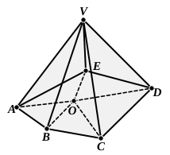

And, since the three angles of each of the triangles ">$ABC$, 
">$ACD$, ">$ADB$ are equal to two right angles,

therefore the nine angles of the three triangles, the angles 
$CBA$, $ACB$, $BAC$, $ACD$, $CDA$, $CAD$, $ADB$, $DBA$, $BAD$ 
are equal to six right angles ;

and of them the six angles $ABC$, $BCA$, $ACD$, $CDA$, $ADB$, 
$DBA$ are greater than two right angles ;

therefore the remaining three angles $BAC$, $CAD$, $DAB$ 
containing the solid angle are less than four right angles.

Therefore etc. 
Q. E. D.

---

It will be observed that, although Euclid enunciates this proposition for 
*any* solid angle, he only proves it for the particular case of a *trihedral* angle. 
This is in accordance with his manner of proving one case and leaving the 
others to the reader. The omission of the convex polyhedral angle here 
corresponds to the omission, after I. 32, of the proposition about the interior 
angles of a convex polygon given by Proclus and in most books. The proof 
of the present proposition for any convex polyhedral angle can of course be 
arranged so as not to assume the proposition that the interior angles of a 
convex polygon together with four right angles are equal to twice as many 
right angles as the figure has sides.

Let there be any convex polyhedral angle with $V$ as vertex, and let it be 
cut by any plane meeting its faces in, say, the 
polygon ">$ABCDE$.

Take $O$ any point within the polygon, and 
in its plane, and join $OA$, $OB$, $OC$, $OD$, $OE$.

Then all the angles of the triangles with 
vertex $O$ are equal to twice as many right angles 
as the polygon has sides; [I. 32] 
therefore the interior angles of the polygon to- 
gether with all the angles round $O$ are equal to 
twice as many right angles as the polygon has 
sides.

Also the sum of the angles of the triangles 
">$VAB$, ">$VBC$, etc., with vertex $V$ are equal to twice as many right angles as the 
polygon has sides; 
and all the said angles are equal to the sum of (1) the plane angles at $V$ 
forming the polyhedral angle and (2) the base angles of the triangles with 
vertex $V$.

This latter sum is therefore equal to the sum of (3) all the angles 
round $O$ and (4) all the interior angles of the polygon.

Now, by Euclid's proposition, of the three angles forming the solid angle at 
$A$, the angles $VAE$, $VAB$ are together greater than the angle $EAB$.

Similarly, at $B$, the angles $VBA$, $VBC$ are together greater than the angle 
$ABC$.

And so on.

Therefore, by addition, the base angles of the triangles with vertex $V$
