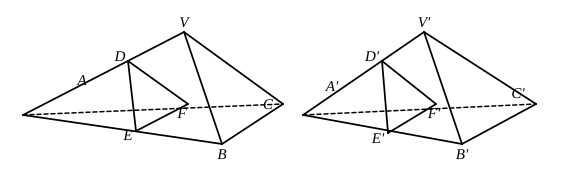

[(2) above] are together greater than the sum of the angles of the polygon 
[(4) above].

Hence, by way of compensation, the sum of the plane angles at $V$ [(1) 
above] is less than the sum of the angles round $O$ [(3) above].

But the latter sum is equal to four right angles; therefore the plane angles 
forming the polyhedral angle are together less than four right angles.

The proposition is only true of *convex* polyhedral angles, i.e. those in 
which the plane of any face cannot, if produced, ever cut the solid angle.

There are certain propositions relating to equal (and symmetrical) trihe- 
dral angles which are necessary to the consideration of the polyhedra dealt 
with by Euclid, all of which (as before remarked) have trihedral angles only.

1. *Two trihedral angles are equal if two face angles and the included 
dihedral angle of the one are respectively equal to two face angles and the included 
dihedral angle of the other, the equal parts being arranged in the same order.*

2. *Two trihedral angles are equal if two dihedral angles and the included 
face angle of the one are respectively equal to two dihedral angles and the included 
face angle of the other, all equal parts being arranged in the same order.*

These propositions are proved immediately by superposition.

3. *Two trihedral angles are equal if the three face angles of the one are 
respectively equal to the three face angles of the other, and all are arranged in the 
same order.*

Let ">$V\text{—}ABC$ and ">$V'\text{—}A'B'C'$ be two trihedral angles such that the angle 
$AVB$ is equal to the angle $A'V'B'$, the angle $BVC$ to the angle $B'V'C'$, and 
the angle $CVA$ to the angle $C'V'A'$.

We first prove that *corresponding pairs of face angles include equal dihedral 
angles*.

E.g., the dihedral angle formed by the plane angles $CVA$, $AVB$ is equal 
to that formed by the plane angles $C'V'A'$, $A'V'B'$.

Take points $A$, $B$, $C$ on $VA$, $VB$, $VC$ and points $A'$, $B'$, $C'$ on $V'A'$, 
$V'B'$, $V'C'$, such that $VA$, $VB$, $VC$, $V'A'$, $V'B'$, $V'C'$ are all equal.

Join $BC$, $CA$, $AB$, $B'C'$, $C'A'$, $A'B'$.

Take any point $D$ on $AV$, and measure $A'D'$ along $A'V'$ equal to $AD$.

From $D$ draw $DE$ in the plane ">$AVB$, and $DF$ in the plane ">$CVA$, 
perpendicular to $AV$. Then $DE$, $DF$ will meet $AB$, $AC$ respectively, the 
angles $VAB$, $VAC$, the base angles of two isosceles triangles, being less than 
right angles.

Join $EF$.

Draw the triangle ">$D'E'F'$ in the same way.
