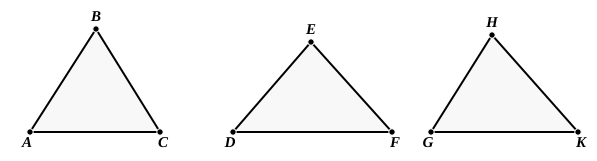
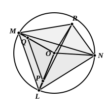

Let the angles $ABC$, $DEF$, $GHK$ be the three given plane angles, and let two of these, taken together in any manner, be greater than the remaining one, while, further, the three are less than four right angles;
thus it is required to construct a solid angle out of angles equal to the angles $ABC$, $DEF$, $GHK$.

Let $AB$, $BC$, $DE$, $EF$, $GH$, $HK$ be cut off equal to one another,
and let $AC$, $DF$, $GK$ be joined;
it is therefore possible to construct a triangle out of straight lines equal to $AC$, $DF$, $GK$. [XI. 22]
Let ">$LMN$ be so constructed that $AC$ is equal to $LM$, $DF$ to $MN$, and further $GK$ to $NL$,
let the circle $LMN$ be described about the triangle ">$LMN$,
let its centre be taken, and let it be $O$;
let $LO$, $MO$, $NO$ be joined;
I say that $AB$ is greater than $LO$.

For, if not, $AB$ is either equal to $LO$, or less.
First, let it be equal.
Then, since $AB$ is equal to $LO$,
while $AB$ is equal to $BC$, and $OL$ to $OM$,
the two sides $AB$, $BC$ are equal to the two sides $LO$, $OM$ respectively;
and, by hypothesis, the base $AC$ is equal to the base $LM$;
therefore the angle $ABC$ is equal to the angle $LOM$. [I. 8]
For the same reason the angle $DEF$ is also equal to the angle $MON$,
and further the angle $GHK$ to the angle $NOL$;
