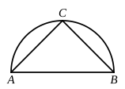

And, since the two sides $LR$, $RM$ are equal to the two 
sides $AB$, $BC$, 
and the base $LM$ is by hypothesis equal to the base $AC$,

therefore the angle $LRM$ is equal to the angle $ABC$. [I. 8]

For the same reason

the angle $MRN$ is also equal to the angle $DEF$, 
and the angle $LRN$ to the angle $GHK$.

Therefore, out of the three plane angles $LRM$, $MRN$, 
$LRN$, which are equal to the three given angles $ABC$, $DEF$, 
$GHK$, the solid angle at $R$ has been constructed, which is 
contained by the angles $LRM$, $MRN$, $LRN$.

Q. E. F.

### LEMMA.

But how it is possible to take the square on $OR$ equal to 
that area by which the square on $AB$ is 
greater than the square on $LO$, we can show 
as follows.

Let the straight lines $AB$, $LO$ be 
set out, 
and let $AB$ be the greater; 
let the semicircle $ABC$ be described on $AB$, 
and into the semicircle $ABC$ let $AC$ be fitted equal to the 
straight line $LO$, not being greater than the diameter $AB$; [IV. 1] 
let $CB$ be joined.

Since then the angle $ACB$ is an angle in the semicircle 
$ACB$,

therefore the angle $ACB$ is right. [III. 31]

Therefore the square on $AB$ is equal to the squares on 
$AC$, $CB$. [I. 47]

Hence the square on $AB$ is greater than the square on 
$AC$ by the square on $CB$.

But $AC$ is equal to $LO$.

Therefore the square on $AB$ is greater than the square on 
$LO$ by the square on $CB$.

If then we cut off $OR$ equal to $BC$, the square on $AB$ will 
be greater than the square on $LO$ by the square on $OR$.

Q. E. F.

---

The whole difficulty in this proposition is the proof of a fact which makes 
the construction *possible*, viz. the fact that, if ">$LMN$ be a triangle with sides
