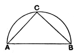

And, since the two sides *LR*, *RM* are equal to the two sides *AB*, *BC*,
and the base *LM* is by hypothesis equal to the base *AC*,
therefore the angle *LRM* is equal to the angle *ABC*. [I. 8]
For the same reason the angle *MRN* is also equal to the angle *DEF*,
and the angle *LRN* to the angle *GHK*.
Therefore, out of the three plane angles *LRM*, *MRN*, *LRN*, which are equal to the three given angles *ABC*, *DEF*, *GHK*, the solid angle at *R* has been constructed, which is contained by the angles *LRM*, *MRN*, *LRN*.

Q. E. F.

### LEMMA.

But how it is possible to take the square on *OR* equal to that area by which the square on *AB* is greater than the square on *LO*, we can show as follows.
Let the straight lines *AB*, *LO* be set out,
and let *AB* be the greater;
let the semicircle *ABC* be described on *AB*,
and into the semicircle *ABC* let *AC* be fitted equal to the straight line *LO*, not being greater than the diameter *AB*; [IV. 1]
let *CB* be joined.

Since then the angle *ACB* is an angle in the semicircle *ACB*,
therefore the angle *ACB* is right. [III. 31]
Therefore the square on *AB* is equal to the squares on *AC*, *CB*. [I. 47]
Hence the square on *AB* is greater than the square on *AC* by the square on *CB*.
But *AC* is equal to *LO*.
Therefore the square on *AB* is greater than the square on *LO* by the square on *CB*.
If then we cut off *OR* equal to *BC*, the square on *AB* will be greater than the square on *LO* by the square on *OR*.

Q. E. F.

---

The whole difficulty in this proposition is the proof of a fact which makes the construction *possible*, viz. the fact that, if *LMN* be a triangle with sides
