(2) Suppose that $AB$ $<$ $LO$. 
Make $OP$, $OQ$ (measured along $OL$, $OM$) each equal to $AB$. 
Thus, $OL$, $OM$ being equal also, it follows that 
$PQ$ is $\parallel$ to $LM$. 
Hence $LM$ $:$ $PQ$ $=$ $LO$ $:$ $OP$; 
and, since $LO$ $>$ $OP$, 
$LM$, i.e. $AC$, $>$ $PQ$. 
Thus, in $\Delta\text{s}$ ">$POQ$, ">$ABC$, two sides are equal to two sides, and base 
$AC$ $>$ base $PQ$; 
therefore $\angle ABC$ $>$ $\angle POQ$, i.e. $\angle LOM$. 
Similarly $\angle DEF$ $>$ $\angle MON$, 
$\angle GHK$ $>$ $\angle NOL$, 
and it follows by addition that 
$\angle ABC$ $+$ $\angle DEF$ $+$ $\angle GHK$ $>$ (four right angles): 
which again contradicts the hypothesis.

### Case II.

(1) Suppose, if possible, that $AB$ $=$ $LO$. 
Then ($AB$ $+$ $BC$), or ($DE$ $+$ $EF$) $=$ $MO$ $+$ $OL$ 
$=$ $MN$ 
$=$ $DF$; 
which contradicts the hypothesis. 
(2) The supposition that $AB$ $<$ $LO$ is even more 
impossible; for in this case it would result that 
$DE$ $+$ $EF$ $<$ $DF$.

### Case III.

(1) Suppose, if possible, that $AB$ $=$ $LO$. 
Then, in the triangles ">$ABC$, ">$LOM$, two sides $AB$, $BC$ are respectively 
equal to two sides $LO$, $OM$, and the bases 
$AC$, $LM$ are equal; 
therefore $\angle ABC$ $=$ $\angle LOM$. 
Similarly $\angle GHK$ $=$ $\angle NOL$. 
Therefore, by addition, 
$\angle MON$ $=$ $\angle ABC$ $+$ $\angle GHK$ 
$>$ $\angle DEF$ (by hypothesis). 
But, in the triangles ">$DEF$, ">$MON$, which 
are equal in all respects, 
$\angle MON$ $=$ $\angle DEF$. 
But it was proved that $\angle MON$ $>$ $\angle DEF$: 
which is impossible.

(2) Suppose, if possible, that $AB$ $<$ $LO$. 
Along $OL$, $OM$ measure $OP$, $OQ$ each equal to $AB$.

