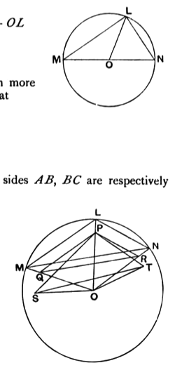

(2) Suppose that $AB < LO$.  
Make $OP, OQ$ (measured along $OL, OM$) each equal to $AB$.  
Thus, $OL, OM$ being equal also, it follows that  
$PQ$ is $\parallel$ to $LM$.  
Hence $LM : PQ = LO : OP$;  
and, since $LO > OP$,  
$LM$, i.e. $AC, > PQ$.  
Thus, in $\Delta\text{s } POQ, ABC$, two sides are equal to two sides, and base $AC > \text{base } PQ$;  
therefore $\angle ABC > \angle POQ$, i.e. $\angle LOM$.  
Similarly $\angle DEF > \angle MON$,  
$\angle GHK > \angle NOL$,  
and it follows by addition that  
$\angle ABC + \angle DEF + \angle GHK > \text{(four right angles)}:$  
which again contradicts the hypothesis.

### Case II.

(1) Suppose, if possible, that $AB = LO$.  
Then $(AB + BC)$, or $(DE + EF) = MO + OL$  
$= MN$  
$= DF$;  
which contradicts the hypothesis.

(2) The supposition that $AB < LO$ is even more impossible; for in this case it would result that  
$$DE + EF < DF.$$

### Case III.

(1) Suppose, if possible, that $AB = LO$.  
Then, in the triangles $ABC$, $LOM$, two sides $AB$, $BC$ are respectively equal to two sides $LO$, $OM$, and the bases $AC$, $LM$ are equal;  
therefore $\angle ABC = \angle LOM$.  
Similarly $\angle GHK = \angle NOL$.  
Therefore, by addition,  
$$\angle MON = \angle ABC + \angle GHK$$  
$$> \angle DEF\text{ (by hypothesis)}.$$  
But, in the triangles $DEF$, $MON$, which are equal in all respects,  
$$\angle MON = \angle DEF.$$  
But it was proved that $\angle MON > \angle DEF$:  
which is impossible.

(2) Suppose, if possible, that $AB < LO$.  
Along $OL$, $OM$ measure $OP$, $OQ$ each equal to $AB$.

