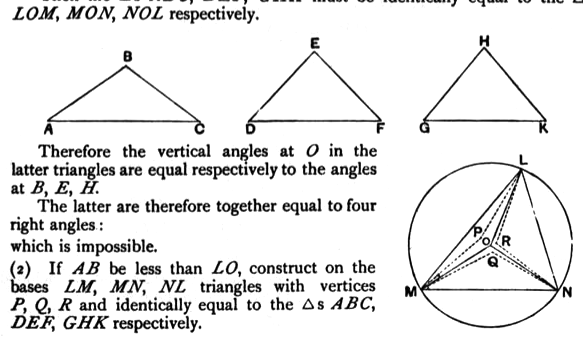

Then $LM, PQ$ are parallel, and  
$$LM : PQ = LO : OP,$$  
whence, since $LO > OP$,  
$$LM\text{, or } AC, > PQ.$$  
Thus, in the triangles $ABC, POQ$,  
$$\angle ABC > \angle POQ\text{, i.e. }\angle LOM.$$  
Similarly, by taking $OR$ along $ON$ equal to $AB$, we prove that  
$$\angle GHK > \angle LON.$$  
Now, at $O$, make $\angle POS$ equal to $\angle ABC$, and $\angle POT$ equal to $\angle GHK$.  
Make $OS, OT$ each equal to $OP$, and join $ST, SP, TP$.  
Then, in the equal triangles $ABC, POS$,  
$$AC = PS,$$  
so that $LM = PS$.  
Similarly $LN = PT$.  
Therefore in the triangles $MLN, SPT$, since $\angle MLN > \angle SPT$ [this is assumed, but should have been explained],  
$$MN > ST,$$  
or $DF > ST$.  
Lastly, in $\Delta\text{s } DEF, SOT$, which have two sides equal to two sides, since $DF > ST$,  
$$\angle DEF > \angle SOT$$  
$$> \angle ABC + \angle GHK\text{ (by construction)}:$$  
which contradicts the hypothesis.

Simson gives rather different proofs for all three cases; but the essence of them can be put, I think, a little more shortly than in his text, as well as more clearly

### Case I. ($O$ within $\Delta LMN$.)

(1) Let $AB$ be, if possible, equal to $LO$.  
Then the $\Delta\text{s } ABC, DEF, GHK$ must be identically equal to the $\Delta\text{s } LOM, MON, NOL$ respectively.

Therefore the vertical angles at $O$ in the latter triangles are equal respectively to the angles at $B, E, H$.  
The latter are therefore together equal to four right angles:  
which is impossible.

(2) If $AB$ be less than $LO$, construct on the bases $LM, MN, NL$ triangles with vertices $P, Q, R$ and identically equal to the $\Delta\text{s } ABC, DEF, GHK$ respectively.
