Then $P$, $Q$, $R$ will fall within the respective angles at $O$, since $PL$ $=$ $PM$ and $<$ $LO$, and similarly in the other cases.  
Thus [I. 21] the angles at $P$, $Q$, $R$ are respectively greater than the angles at $O$ in which they lie.  
Therefore the sum of the angles at $P$, $Q$, $R$, i.e. the sum of the angles at $B$, $E$, $H$, is greater than four right angles:  
which again contradicts the hypothesis.

### Case II. ($O$ lying on $MN$.)

In this case, whether (1) $AB$ $=$ $LO$, or (2) $AB$ $<$ $LO$, a triangle cannot be formed with $MN$ as base and each of the other sides equal to $AB$. In other words, the triangle ">$DEF$ either reduces to a straight line or is impossible.

### Case III. ($O$ lying outside the ">$\Delta LMN$.)

(1) Suppose, if possible, that $AB$ $=$ $LO$.  
Then the triangles ">$LOM$, ">$MON$, ">$NOL$ are identically equal to the triangles ">$ABC$, ">$DEF$, ">$GHK$.  
Since  
$\angle LOM$ $+$ $\angle LON$ $=$ $\angle MON$,  
$\angle ABC$ $+$ $\angle GHK$ $=$ $\angle DEF$:  
which contradicts the hypothesis.

(2) Suppose that $AB$ $<$ $OL$.  
Draw, as before, on $LM$, $MN$, $NL$ as bases triangles with vertices $P$, $Q$, $R$ and identically equal to the $\Delta\text{s}$ ">$ABC$, ">$DEF$, ">$GHK$.  
Next, at $N$ on the straight line $NR$, make $\angle RNS$ equal to the angle $PLM$, cut off $NS$ equal to $LM$ and join $RS$, $LS$.  
Then ">$\Delta NRS$ is identically equal to ">$\Delta LPM$ or ">$\Delta ABC$.  
Now  
($\angle LNR$ $+$ $\angle RNS$) $<$ ($\angle NLO$ $+$ $\angle OLM$),  
that is, $\angle LNS$ $<$ $\angle NLM$.  
Thus, in $\Delta\text{s}$ ">$LNS$, ">$NLM$, two sides are equal to two sides, and the included angle in the former is less than the included angle in the other.  
Therefore  
$LS$ $<$ $MN$.
