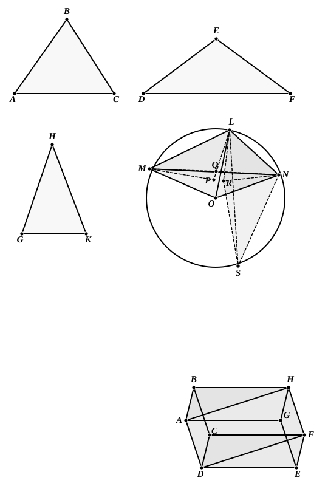

Hence, in the triangles ">$MQN$, ">$LRS$, two sides are equal to two sides, and $MN$ $>$ $LS$.  
Therefore  
$\angle MQN$ $>$ $\angle LRS$  
$>$ ($\angle LRN$ $+$ $\angle SRN$)  
$>$ ($\angle LRN$ $+$ $\angle LPM$).  
That is,  
$\angle DEF$ $>$ ($\angle GHK$ $+$ $\angle ABC$):  
which is impossible.

---

### PROPOSITION 24.

*If a solid be contained by parallel planes, the opposite planes in it are equal and parallelogrammic.*

For let the solid ">$CDHG$ be contained by the parallel planes ">$AC$, ">$GF$, ">$AH$, ">$DF$, ">$BF$, ">$AE$;  
I say that the opposite planes in it are equal and parallelogrammic.  
For, since the two parallel planes ">$BG$, ">$CE$ are cut by the plane ">$AC$,  
their common sections are parallel. [XI. 16]
