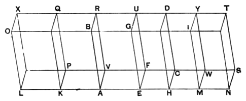

### PROPOSITION 25.

*If a parallelepipedal solid be cut by a plane which is parallel to the opposite planes, then, as the base is to the base, so will the solid be to the solid.*

For let the parallelepipedal solid $ABCD$ be cut by the plane $FG$ which is parallel to the opposite planes $RA, DH$;  
I say that, as the base $AEFV$ is to the base $EHCF$, so is the solid $ABFU$ to the solid $EGCD$.

For let $AH$ be produced in each direction,  
let any number of straight lines whatever, $AK, KL$, be made equal to $AE$,  
and any number whatever, $HM, MN$, equal to $EH$;  
and let the parallelograms $LP, KV, HW, MS$ and the solids $LQ, KR, DM, MT$ be completed.  
Then, since the straight lines $LK, KA, AE$ are equal to one another,  
the parallelograms $LP, KV, AF$ are also equal to one another,  
$KO, KB, AG$ are equal to one another,  
and further $LX, KQ, AR$ are equal to one another, for they are opposite. [XI. 24]  
For the same reason  
the parallelograms $EC, HW, MS$ are also equal to one another,  
$HG, HI, IN$ are equal to one another,  
and further $DH, MY, NT$ are equal to one another.  
Therefore in the solids $LQ, KR, AU$ three planes are equal to three planes.
