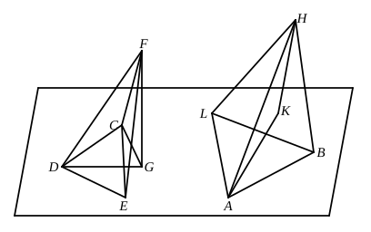

though it is true, where no solid angle in the figures is contained by more than three plane angles, that two solid figures are equal and similar which are contained by the same number of equal and similar faces, similarly arranged, the fact should have been proved. To do this, we have only to prove the proposition, given above in the note on XI. 21, that *two trihedral angles are equal if the three face angles of the one are respectively equal to the three face angles in the other, and all are arranged in the same order*, and then to prove equality by applying one figure to the other as is done by Simson in his proposition C.

Application will also, of course, establish what is assumed by Euclid of the solids formed by the multiples of the original solids, namely that, if ">$LF$ $\gtreqqless$ ">$NF$, the solid ">$LU$ $\gtreqqless$ the solid ">$NU$.

---

### PROPOSITION 26.

*On a given straight line, and at a given point on it, to construct a solid angle equal to a given solid angle.*

Let $AB$ be the given straight line, $A$ the given point on it, and the angle at $D$, contained by the angles $EDC$, $EDF$, $FDC$, the given solid angle;  
thus it is required to construct on the straight line $AB$, and at the point $A$ on it, a solid angle equal to the solid angle at $D$.

For let a point $F$ be taken at random on $DF$,  
let $FG$ be drawn from $F$ perpendicular to the plane through $ED$, $DC$, and let it meet the plane at $G$, [XI. 11]  
let $DG$ be joined,  
let there be constructed on the straight line $AB$ and at the point $A$ on it the angle $BAL$ equal to the angle $EDC$, and the angle $BAK$ equal to the angle $EDG$, [I. 23]  
let $AK$ be made equal to $DG$,
