Therefore on the straight line $AB$, and at the point $A$ on 
it, a solid angle has been constructed equal to the given solid 
angle at $D$.Q. E. F.

---

This proposition again assumes the equality of two trihedral angles which 
have the three plane angles of the one respectively equal to the three plane 
angles of the other taken in the same order.

---

### PROPOSITION 27.

On a given straight line to describe a parallelepipedal solid 
similar and similarly situated to a given parallelepipedal solid.

Let $AB$ be the given straight line and ">$CD$ the given 
parallelepipedal solid ; 
thus it is required to describe on the given straight line $AB$ 
a parallelepipedal solid similar and similarly situated to the 
given parallelepipedal solid ">$CD$.

For on the straight line $AB$ and at the point $A$ on it let 
the solid angle, contained by the angles $BAH$, $HAK$, $KAB$, 
be constructed equal to the solid angle at $C$, so that the angle 
$BAH$ is equal to the angle $ECF$, the angle $BAK$ equal to 
the angle $ECG$, and the angle $KAH$ to the angle $GCF$ ; 
and let it be contrived that, 
as $EC$ is to $CG$, so is $BA$ to $AK$, 
and, as $GC$ is to $CF$, so is $KA$ to $AH$. [VI. 12]

Therefore also, <em>ex aequali</em>, 
as $EC$ is to $CF$, so is $BA$ to $AH$. [V. 22]

Let the parallelogram ">$HB$ and the solid ">$AL$ be completed.

Now since, as $EC$ is to $CG$, so is $BA$ to $AK$, 
and the sides about the equal angles $ECG$, $BAK$ are thus 
proportional,

