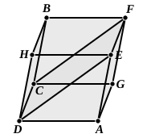

therefore the parallelogram ">$GE$ is similar to the parallelo- 
gram ">$KB$.

For the same reason 
the parallelogram ">$KH$ is also similar to the parallelogram ">$GF$, 
and further ">$FE$ to ">$HB$ ; 
therefore three parallelograms of the solid ">$CD$ are similar to 
three parallelograms of the solid ">$AL$.

But the former three are both equal and similar to the 
three opposite parallelograms, 
and the latter three are both equal and similar to the three 
opposite parallelograms ;

therefore the whole solid ">$CD$ is similar to the whole solid ">$AL$. 
[XI. Def. 9]

Therefore on the given straight line $AB$ there has been 
described ">$AL$ similar and similarly situated to the given 
parallelepipedal solid ">$CD$.Q. E. F.

---

### PROPOSITION 28.

If a parallelepipedal solid be cut by a plane through the 
diagonals of the opposite planes, the solid will be bisected by the 
plane.

For let the parallelepipedal solid ">$AB$ be cut by the plane 
">$CDEF$ through the diagonals $CF$, $DE$ of 
opposite planes ; 
I say that the solid ">$AB$ will be bisected by 
the plane ">$CDEF$.

For, since the triangle ">$CGF$ is equal 
to the triangle ">$CFB$, [I. 34] 
and ">$ADE$ to ">$DEH$, 
while the parallelogram ">$CA$ is also equal 
to the parallelogram ">$EB$, for they are opposite, 
and ">$GE$ to ">$CH$,

therefore the prism contained by the two triangles ">$CGF$, 
">$ADE$ and the three parallelograms ">$GE$, ">$AC$, ">$CE$ is also equal 
to the prism contained by the two triangles ">$CFB$, ">$DEH$ and 
the three parallelograms ">$CH$, ">$BE$, ">$CE$ ;

