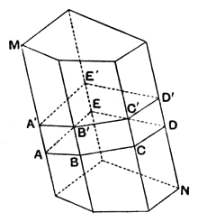

for they are contained by planes equal both in multitude and in magnitude. [XI. Def. 10]

Hence the whole solid *AB* is bisected by the plane *CDEF*.

Q. E. D.

---

Simson properly observes that it ought to be proved that the diagonals of two opposite faces are in one plane, before we speak of drawing a plane through them. Clavius supplied the proof, which is of course simple enough.

Since *EF*, *CD* are both parallel to *AG* or *BH*, they are parallel to one another.

Consequently a plane can be drawn through *CD*, *EF* and the diagonals *DE*, *CF* are in that plane [XI. 7]. Moreover *CD*, *EF* are equal as well as parallel; so that *CF*, *DE* are also equal and parallel.

Simson does not, however, seem to have noticed a more serious difficulty. The two prisms are shown by Euclid to be contained by equal faces—the faces are in fact equal and similar—and Euclid then infers at once that the prisms are *equal*. But they are not equal in the only sense in which we have, at present, a right to speak of solids being equal, namely in the sense that they can be *applied*, the one to the other. They cannot be so applied because the faces, though equal respectively, are not *similarly arranged*; consequently the prisms are *symmetrical*, and it ought to be proved that they are, though not equal and similar, equal in content, or *equivalent*, as Legendre has it.

Legendre addressed himself to proving that the two prisms are equivalent, and his method has been adopted, though his name is not mentioned, by Schultze and Sevenoak and by Holgate. Certain preliminary propositions are necessary.

**1.** *The sections of a prism made by parallel planes cutting all the lateral edges are equal polygons.*

Suppose a prism *MN* cut by parallel planes which make sections *ABCDE*, *A'B'C'D'E'*.

Now *AB*, *BC*, *CD*, ... are respectively parallel to *A'B'*, *B'C'*, *C'D'*, ... [XI. 16]

Therefore the angles *ABC*, *BCD*, ... are equal to the angles *A'B'C'*, *B'C'D'*, ... respectively. [XI. 10]

Also *AB*, *BC*, *CD*, ... are respectively equal to *A'B'*, *B'C'*, *C'D'*, ... [I. 34]

Thus the polygons *ABCDE*, *A'B'C'D'E'* are equilateral and equiangular to one another.

**2.** *Two prisms are equal when they have a solid angle in each contained by three faces equal each to each and similarly arranged.*

Let the faces *ABCDE*, *AG*, *AL* be equal and similarly placed to the faces *A'B'C'D'E'*, *A'G'*, *A'L'*.

Since the three plane angles at *A*, *A'* are equal respectively and are similarly placed, the trihedral angle at *A* is equal to the trihedral angle at *A'*. [(3) in note to XI. 21]
