Place the trihedral angle at $A$ on that at $A'$. 
Then the face ">$ABCDE$ coincides with the face ">$A'B'C'D'E'$, the face ">$AG$ 
with the face ">$A'G'$, and the face ">$AL$ with the face ">$A'L'$. 
The point $C$ falls on $C'$ and $D$ on $D'$.

Since the lateral edges of a prism are parallel, $CH$ will fall on $C'H'$, and 
$DK$ on $D'K'$.

And the points $F$, $G$, $L$ coincide respectively with $F'$, $G'$, $L'$, so that 
the planes ">$GK$, ">$G'K'$ coincide.

Hence $H$, $K$ coincide with $H'$, $K'$ respectively. 
Thus the prisms coincide throughout and are equal.

In the same way we can prove that two *truncated* prisms with three faces 
forming a solid angle related to one another as in the above proposition are 
identically equal.

In particular, 
*Cor.* *Two right prisms having equal bases and equal heights are equal.*

**3.** *An oblique prism is equivalent to a right prism whose base is a right 
section of the oblique prism and whose 
height is equal to a lateral edge of the 
oblique prism.*

Suppose ">$GL$ to be a right section of 
the oblique prism ">$AD'$, and let ">$GL'$ be 
a right prism on ">$GL$ as base and with 
height equal to a lateral edge of ">$AD'$.

Now the lateral edges of ">$GL'$ are 
equal to the lateral edges of ">$AD'$.

Therefore $AG$ = $A'G'$, $BH$ = $B'H'$, 
$CK$ = $C'K'$, etc.

Thus the faces ">$AH$, ">$BK$, ">$CL$ are 
equal respectively to the faces ">$A'H'$, 
">$B'K'$, ">$C'L'$.

Therefore [by the proposition 
above] 
(truncated prism ">$AL$) = (truncated 
prism ">$A'L'$).

Subtracting each from the whole solid ">$AL'$, we see that 
the prisms ">$AD'$, ">$GL'$ are equivalent.
