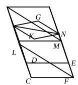

Now suppose the parallelepiped of Euclid's proposition to be cut by the 
plane through $AG$, $DF$.

Let ">$KLMN$ be a right section of the parallelepiped 
cutting the edges $AD$, $BC$, $GF$, $HE$. 
Then ">$KLMN$ is a parallelogram; and, if the 
diagonal $KM$ be drawn,

">$\triangle KLM$ = ">$\triangle MNK$.

Now the prism of which the $\Delta\text{s}$ ">$ABG$, ">$DCF$ are 
the bases is equal to the right prism on ">$\triangle KLM$ as 
base and of height $AD$.

Similarly the prism of which the $\Delta\text{s}$ ">$AGH$, ">$DFE$ 
are the bases is equal to the right prism on ">$\triangle MNK$ 
as base and with height $AD$. [(3) above]

And the right prisms on $\Delta\text{s}$ ">$KLM$, ">$MNK$ as bases and of equal height 
$AD$ are equal. [(2), Cor. above]

Consequently the two prisms into which the parallelepiped is divided are 
equivalent.

---

### PROPOSITION 29.

Parallelepipedal solids which are on the same base and of 
the same height, and in which the extremities of the sides which 
stand up are on the same straight lines, are equal to one 
another.

Let ">$CM$, ">$CN$ be parallelepipedal solids on the same base 
">$AB$ and of the same height, 
and let the extremities of their 
sides which stand up, namely 
$AG$, $AF$, $LM$, $LN$, $CD$, $CE$, 
$BH$, $BK$, be on the same straight 
lines $FN$, $DK$; 
I say that the solid ">$CM$ is equal 
to the solid ">$CN$.

For, since each of the figures 
">$CH$, ">$CK$ is a parallelogram, $CB$ 
is equal to each of the straight lines $DH$, $EK$, [I. 34]

hence $DH$ is also equal to $EK$.

Let $EH$ be subtracted from each;

therefore the remainder $DE$ is equal to the remainder $HK$.

Hence the triangle ">$DCE$ is also equal to the triangle 
">$HBK$, [I. 8, 4] 
and the parallelogram ">$DG$ to the parallelogram ">$HN$. [I. 36]

