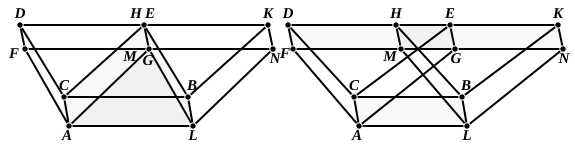

For the same reason the triangle ">$AFG$ is also equal to the triangle ">$MLN$.

But the parallelogram ">$CF$ is equal to the parallelogram ">$BM$, and ">$CG$ to ">$BN$, for they are opposite;  
therefore the prism contained by the two triangles ">$AFG$, ">$DCE$ and the three parallelograms ">$AD$, ">$DG$, ">$CG$ is equal to the prism contained by the two triangles ">$MLN$, ">$HBK$ and the three parallelograms ">$BM$, ">$HN$, ">$BN$.

Let there be added to each the solid of which the parallelogram ">$AB$ is the base and ">$GEHM$ its opposite;  
therefore the whole parallelepipedal solid ">$CM$ is equal to the whole parallelepipedal solid ">$CN$.

Therefore etc.

Q. E. D.

---

As usual, Euclid takes one case only and leaves the reader to prove for himself the two other possible cases shown in the subjoined figures. Euclid's proof holds with a very slight change in each case. With the first figure, the

only difference is that the prism of which the $\Delta\text{s}$ ">$GAL$, ">$ECB$ are the bases takes the place of "the solid of which the parallelogram ">$AB$ is the base and ">$GEHM$ its opposite"; while with the second figure we have to subtract the prisms which are proved equal successively from the solid of which the parallelogram ">$AB$ is the base and ">$FDKN$ its opposite.

Simson, as usual, suspects mutilation by "some unskilful editor," but gives a curious reason why the case in which the two parallelograms opposite to ">$AB$ have a side common ought not to have been omitted, namely that this case "is immediately deduced from the preceding 28th Prop which seems for this purpose to have been premised to the 29th." But, apart from the fact that Euclid's Prop. 28 does *not* prove the theorem which it enunciates (as we have seen), that theorem is not in the least necessary for the proof of this case of Prop. 29, as Euclid's proof applies to it perfectly well.

---

### PROPOSITION 30.

*Parallelepipedal solids which are on the same base and of the same height, and in which the extremities of the sides which stand up are not on the same straight lines, are equal to one another.*
